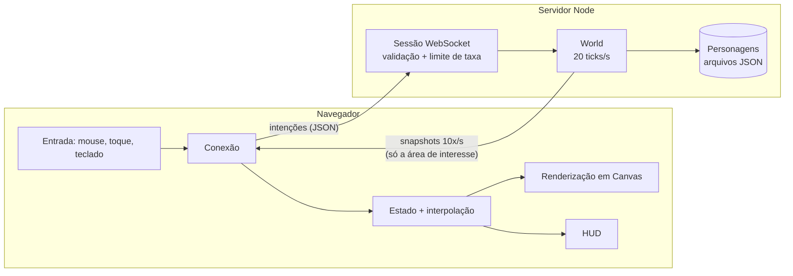

# Valdoria

Protótipo de MMORPG 2D original: mundo de fantasia, combate em tempo real, monstros, níveis e itens, com servidor multiplayer próprio. O servidor é escrito em Node.js com TypeScript e o cliente roda no navegador, desenhado em Canvas.

Todo o conteúdo é original (código, arte, nomes e mapa). A inspiração é o gênero dos MMORPGs de ação clássicos, não um jogo específico.

## O que já funciona

- **Mundo de 96 x 96 tiles** gerado a partir de uma seed: vila central, campos, florestas, lagos com pontes e ruínas. Servidor e cliente geram o mesmo mapa, então só a seed trafega pela rede.
- **Três classes** com estilos diferentes: Guerreiro (corpo a corpo), Arqueira (longo alcance) e Mago (dano em área). Cada uma tem uma habilidade com custo de mana e recarga.
- **Sete monstros** distribuídos por zonas de dificuldade, com IA de perseguição, desistência ao se afastar demais de casa e um chefe, o Ogro Ancestral.
- **Progressão**: experiência dividida pelo dano causado, 20 níveis, penalidade leve ao morrer e renascimento na vila.
- **Itens**: ouro, poções e equipamentos em três faixas, com loot reservado para quem venceu por 15 segundos.
- **Multiplayer**: vários jogadores no mesmo mundo, chat global e bots opcionais.
- **Personagens salvos** pelo nome, com salvamento automático a cada 30 segundos.
- **Demo offline** num único arquivo HTML, em que a simulação do servidor roda dentro da página.

## Como rodar

Requisitos: [Node.js](https://nodejs.org) 20 ou mais novo (recomendado: 22).

```bash
npm install
npm run dev
```

Abra <http://localhost:3000>. O modo `dev` recompila o cliente a cada alteração, reinicia o servidor sozinho e coloca 3 bots no mundo.

Para rodar a versão compilada:

```bash
npm run build
npm start
```

### Configuração

Tudo é configurado por variáveis de ambiente:

| Variável      | Padrão        | Para que serve                                                  |
| ------------- | ------------- | --------------------------------------------------------------- |
| `PORT`        | `3000`        | Porta HTTP e WebSocket                                          |
| `HOST`        | `127.0.0.1`   | Use `0.0.0.0` para aceitar conexões de outras máquinas          |
| `BOTS`        | `0`           | Quantos jogadores simulados colocar no mundo (até 20)           |
| `SEED`        | `20261015`    | Seed do mapa                                                    |
| `MAX_PLAYERS` | `100`         | Limite de jogadores conectados                                  |
| `DATA_DIR`    | `data`        | Pasta onde os personagens são salvos                            |

Para jogar com amigos na mesma rede: `HOST=0.0.0.0 npm start` e cada pessoa abre `http://SEU_IP:3000`.

### Demo offline

```bash
npm run build:demo
```

Gera `dist/demo/valdoria-demo.html`, com o jogo inteiro num arquivo só. É a versão publicada como demonstração.

## Como jogar

| Ação                      | Mouse / toque                       | Teclado |
| ------------------------- | ----------------------------------- | ------- |
| Andar                     | Clicar (ou segurar) no chão         |         |
| Atacar                    | Clicar no monstro                   |         |
| Habilidade da classe      | Botão direito no monstro            | `1`     |
| Pegar item do chão        | Clicar no item                      |         |
| Poção de vida / mana      | Botões da barra de ações            | `Q` / `E` |
| Inventário                | Botão da bolsa                      | `I`     |
| Chat                      | Campo no canto inferior esquerdo    | `Enter` |
| Cancelar ação             |                                     | `Esc`   |

Na vila ninguém luta. Quanto mais longe dela, mais fortes os monstros: Campos de Lírio (nível 1 a 3), Bosque dos Lobos (4 a 8) e Ruínas Esquecidas (9 ou mais).

## Arquitetura



Decisões principais:

- **Servidor autoritativo.** O cliente só envia intenções ("andar até ali", "atacar aquele monstro"). Posição, dano, drops e experiência são calculados no servidor. Isso fecha a porta para as trapaças mais comuns (velocidade, dano, teleporte).
- **Passo fixo.** A simulação avança em ticks de 50 ms, com um relógio próprio. O resultado não depende da velocidade da máquina e os testes são reproduzíveis.
- **Área de interesse.** Cada jogador recebe só o que está perto dele, a 10 snapshots por segundo. Economiza banda e evita que alguém "veja o mapa inteiro".
- **Interpolação no cliente.** O navegador desenha o mundo cerca de 110 ms no passado, entre dois snapshots, para o movimento ficar suave com poucas atualizações.
- **Conteúdo em dados.** Classes, monstros, itens e drops ficam em `src/shared/data`. Balancear o jogo é editar números, sem mexer na lógica.
- **Uma simulação, dois lugares.** A classe `World` roda no servidor e, sem mudanças, dentro do navegador na demo offline.
- **Persistência por interface.** Hoje os personagens são arquivos JSON com escrita atômica. Trocar por um banco de dados é implementar a interface `CharacterStore`.

### Estrutura de pastas

```text
src/
  shared/   Código usado por cliente e servidor: protocolo, mapa, dados do jogo, regras de progressão
  game/     Simulação autoritativa: World, pathfinding (A*), IA, inventário, bots
  server/   Servidor Node: HTTP, WebSocket, sessões, salvamento em arquivo
  client/   Cliente web: renderização, HUD, entrada, interpolação
  demo/     Demo offline: cliente + simulação na mesma página
test/       Testes automatizados (Vitest)
scripts/    Build e modo de desenvolvimento (esbuild)
```

`shared/` e `game/` não podem usar APIs do Node nem do navegador. Os dois `tsconfig` garantem isso na checagem de tipos.

## Testes

```bash
npm test          # testes
npm run check     # checagem de tipos + testes + build (o mesmo que a CI roda)
```

Os testes cobrem geração do mapa, pathfinding, validação do protocolo, inventário, progressão, combate, IA dos monstros, morte e renascimento, loot reservado, chat, área de interesse, salvamento, bots, a interpolação do cliente e o servidor real via WebSocket.

## Segurança

Já coberto neste protótipo:

- Toda mensagem do cliente é validada (tipos, faixas de valores, tamanho máximo); campos extras são descartados.
- Limite de mensagens por segundo por conexão; quem insiste em mandar lixo é desconectado.
- Chat limpo de caracteres de controle e invisíveis, com limite de tamanho e de frequência.
- Nomes de personagem restritos a letras sem acento, números e `_`.
- Saves validados ao carregar: arquivo corrompido ou editado não cria itens inexistentes.
- Cabeçalhos de segurança no HTTP (Content-Security-Policy, nosniff) e bloqueio de acesso a arquivos fora da pasta do cliente.
- Por padrão o servidor só aceita conexões da própria máquina.

## Limitações conhecidas

- **Login só pelo nome, sem senha.** Quem souber o nome de um personagem consegue entrar com ele. Antes de colocar o servidor na internet, é preciso ter contas com senha (com hash Argon2 ou bcrypt) ou login social.
- Salvamento em arquivos JSON, adequado para um único processo.
- Um mapa e um canal só, sem grupos, trocas, lojas ou PvP. O ouro ainda não tem onde ser gasto.
- Sem predição de movimento no cliente: com latência alta, o personagem responde com atraso.

## Próximos passos sugeridos

1. Contas com senha e banco de dados (PostgreSQL).
2. Loja na vila para dar uso ao ouro.
3. Grupos com experiência compartilhada.
4. Mais habilidades por classe e novos mapas, com masmorras.
5. Deploy com HTTPS (WebSocket seguro) em um servidor na nuvem.

## Licença e conteúdo

O repositório é público. Mantenha o projeto 100% original: não adicione arquivos, arte, sons ou nomes de jogos comerciais.
